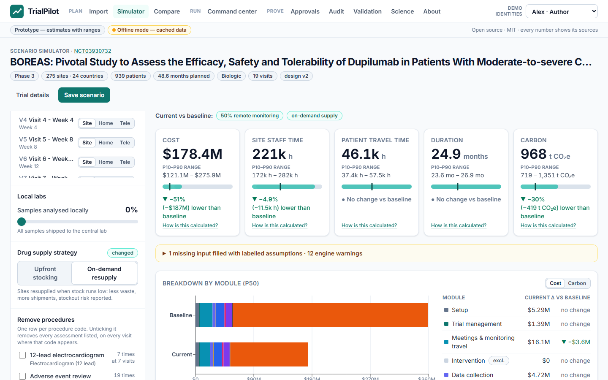

# TrialPilot

**Compare clinical trial designs across cost, site workload, patient travel and timeline risk, with carbon as an additional metric and evidence behind each estimate.**

TrialPilot is an MIT-licensed hackathon prototype connecting scenario planning, an operations command center and software-validation evidence.

**Verified code:** clean-clone run at `e5c386b1fb0b6edf362bf5d37b97cc17066dfd07`: **576 passed, 0 failed/errors/skipped**, **32/32 requirements passed**, and **114 package files downloaded and hash-verified**. Typecheck, production build and all 48 frontend unit tests passed separately in preflight. The package remains **awaiting QA approval**; signatures are automated fictional demos, not human approval. [Full summary](validation/out/clean-clone/20261017T041438Z/summary.json) · [scope and handoff](handoffs/FRONTEND_FINAL.md). Later documentation/media commits do not change this tested code.

**Simulated feeds are synthetic.** Registry records and published reference values are sourced real data. Assumed visit schedules, operating events and UI mock results must retain their assumption, simulated or mock labels.

## Demo media

[12-slide editable deck](docs/assets/trialpilot-deck.pptx) · [180-second real application recording](docs/assets/trialpilot-demo.webm) · [video player with English captions](docs/assets/demo-player.html) · [script](docs/VIDEO_SCRIPT.md)

The video is a silent screen recording with a WebVTT caption track, not a narrated production. It uses the real API on an isolated temporary database; no UI mock or invented result is used. [Media manifest](docs/assets/media-manifest.json) records duration, hashes, source commits and inspection results.



[Protocol review](docs/assets/screenshots/03-protocol-review.png) · [Provenance](docs/assets/screenshots/08-provenance.png) · [Approval demo](docs/assets/screenshots/10-demo-approved.png) · [Synthetic command center](docs/assets/screenshots/12-command.png) · [Validation package](docs/assets/screenshots/16-validation.png)

## Why these decisions matter

These historical figures explain the levers. They are context, not TrialPilot savings or current price estimates.

| Bottleneck | Opened evidence | Interpretation |
|---|---|---|
| Procedures and site work | ASPE's 2014 report lists procedures **15–22%**, administrative staff **11–29%**, monitoring **9–14%**, site retention **9–16%**, and central laboratories **4–12%** across phases. [Report, PDF p. 34](https://aspe.hhs.gov/sites/default/files/migrated_legacy_files//44516/rpt_erg.pdf) | The detailed discussion excludes site overhead and sponsor monitoring. These ranges span phases and are not additive uncertainty bounds. |
| Pivotal trial expense | A 2018 study estimated a **$19.0m** median direct cost per pivotal trial among **138 trials** supporting **59 FDA approvals in 2015–2016**. [Original paper](https://pmc.ncbi.nlm.nih.gov/articles/PMC6248200/) | Historical modelled cost per trial, not total drug-development cost. |
| Study duration | FDA gives Phase 1 **several months**, Phase 2 **several months to 2 years**, and Phase 3 **1–4 years**. [FDA](https://www.fda.gov/patients/drug-development-process/step-3-clinical-research) | Educational ranges, not a forecast for the imported study. |
| Drug supply waste | Clinical Trials Arena reported an industry estimate of **60–70% clinical-trial IMP waste** on May 28, 2025. [Article](https://www.clinicaltrialsarena.com/news/mapping-out-opportunities-to-reduce-emissions-in-clinical-trials/) | Attributed conference estimate in coverage of a Genentech presentation, not a measured baseline for our trial. |

**Regeneron sheet verification is pending:** the starter sheets were not supplied. Tufts site statistics and exact sheet quotations remain unverified. The independent study/FDA figures above must not be described as Regeneron quotations. See the [claim ledger](docs/EVIDENCE.md).

## Architecture

Implemented module boundaries. Dashed feed inputs represent synthetic demo events; production connectors remain future work.


| Directory | Responsibility |
|---|---|
| `contracts/` | Pydantic contracts, parameter schema, JSON Schema and TypeScript |
| `engine/` | Activity calculations, uncertainty, forecast and supply |
| `api/` | Persistence, importers, operations, compliance and HTTP/SSE |
| `web/` | Scenario, command, approval, audit and science views |
| `validation/` | `tpv`, requirements, protocols, evidence and traceability |
| `science/` | Published footprint fixtures and reproduction outputs |
| `data/` | Parameters, cached registry responses and synthetic fixtures |
| `docs/` | Methods, sources and the presentation package |

## Quick start

The verified local route uses API **8008**, UI **5181**, cached records and an independent OS temporary database. Follow the complete [PowerShell setup and walkthrough](docs/DEMO_RUNBOOK.md). Dependencies must already be prepared; the recorded run used locked pnpm **9.15.9** and Edge. Initial installation can require a network.

```powershell
corepack pnpm@9.15.9 --dir web typecheck
corepack pnpm@9.15.9 --dir web build
corepack pnpm@9.15.9 --dir web test
```

The root Makefile also supports `make install` and `make dev` in a configured Bash environment. Docker configuration exists, but Docker was unavailable: **container build/run and deployment are not verified**, and no public deployment URL is claimed. Do not replace that gap with a successful local Vite run.

## Demo walkthrough

1. Import BOREAS **NCT03930732**; distinguish registry facts and missing fields. Choose **Use the registry protocol (cached extraction)**, review page/quotation candidates and **Apply to design** after acceptance. Bulk acceptance is not measured extraction accuracy.
2. **Open scenario simulator**. Set **Monitoring visits done remotely** to 50% and choose **On-demand resupply**. These are hypothetical inputs, not clinical advice; this recording does not change visits or remove procedures.
3. Read cost, site hours, patient travel, duration and carbon ranges. Inspect forecast/supply requested and actual draws. Open **How is this calculated?** for the formula, inputs and parameters.
4. **Save scenario**, then **Submit for approval**. Alex cannot self-approve. Riley reviews and Sam approves with fictional demo PINs. These controls do not establish human QA approval.
5. **Audit → Verify chain**. Open **Command center** at `/command/demo-40`, start the synthetic feed, acknowledge overstock, plan/start an intervention, then **Advance 6 weeks** and inspect the qualified effect.
6. **Science** exposes module gaps. **Validation** shows the package's exact commit, counts, failures and QA state; download its evidence manifest. Optional comparison and concurrency steps appear in the [runbook](docs/DEMO_RUNBOOK.md).

`VITE_MOCK_API=1` is a separate fictional UI mode and cannot establish API, engine or compliance behavior.

## Method and uncertainty

The design reuses activity inputs for cost, site time, patient travel and emissions. Carbon uses activity multiplied by emission factor under the LCCT method, limited to trial-specific activities beyond routine care. [Griffiths et al., 2024](https://pmc.ncbi.nlm.nih.gov/articles/PMC10823997/).

The engine uses seeded triangular sampling and P10/P50/P90 outputs; the science reproduction uses 2,000 draws. Forecast and supply report their own requested and actual counts. These are model quantiles conditional on assumptions, without demonstrated real-world coverage. Consult the published [engine methods](docs/model.md). The [forecast/supply methods](docs/model_forecast.md) document additional limits.

Module ids: `setup`, `trial_management`, `meetings_travel`, `intervention`, `data_collection`, `supplies_equipment`, `patient_assessments`, `samples`, `laboratory`, `closeout`. `drug_supply` is an **extension beyond the published method** and must be separated from like-for-like reproduction. Missing inputs need a visible assumption or warning. Forecasts are planning estimates.

## Science check

Generated output at `e5c386b`, parameter set **1249d0f0eed8**, seed **7**, **2,000 draws**. All numbers below are kg CO2e; percentages use unrounded published references.

| Trial | Published | Paper arithmetic | Engine + library P10 / P50 / P90 | Engine P50 gap |
|---|---:|---:|---:|---:|
| CASPS | 71,938.8 | 71,943.18 (+0.01%) | 64,601.50 / 88,758.48 / 123,510.08 | **+23.38%** |
| PRIMETIME | 89,360.2 | 89,221.19 (−0.16%) | 87,891.34 / 109,685.91 / 142,685.69 | **+22.75%** |

[Generated JSON](science/out/results.json) · [published method, CC BY 4.0](https://pmc.ncbi.nlm.nih.gov/articles/PMC10823997/) · [backend explanation](handoffs/BACKEND_FINAL.md). Both references lie inside engine ranges; that is not proof of real-world coverage. Paper arithmetic, library-factor ledgers and full-engine structural checks are separate. Direct and WTT factors are counted once each. The old **+5%/+7%** engine claims are obsolete.

The comparison excludes the `drug_supply` extension. PRIMETIME visits cover all 1,962 rather than the 1,623 subgroup; hospital utilities and some sample/audit activity are absent, and assumed monitoring/initiation/closeout activity differs. Offsetting module differences can conceal structural gaps. Carbon reproduction does not validate cost, workload, forecast or intervention accuracy.

Cold compute in this complete run: **median 147.8 ms**, seven distinct seeds 200–206, every response `X-Cache: miss`, 2,000 requested forecast draws, measured by `X-Compute-Ms`; unchanged target <300 ms passed. It is server compute timing, not browser interaction latency. Earlier standalone median **308.2 ms** missed the target; the historical `38e2073` full run recorded **664.1 ms** and failed. These records are preserved, not rewritten. [Final summary](validation/out/clean-clone/20261017T041438Z/summary.json), [earlier cold observation](validation/out/backend/20261017T041106Z-cold/benchmark.json).

## Validation package

[Exact tested execution](validation/out/clean-clone/20261017T041438Z/summary.json) · [package index](validation/out/clean-clone/20261017T041438Z/package/index.html) · [summary report](validation/out/clean-clone/20261017T041438Z/package/report.md) · [download/hash checks](validation/out/clean-clone/20261017T041438Z/package-downloads.json).

The complete isolated run has **576 passed, 0 failed/errors/skipped**, **32/32 traced requirements passed**, no untested requirements and no evidence-integrity problems. All 114 package files were downloaded and hash-verified; the package audit snapshot is intact across 12 entries (14 in the final post-packaging audit). The 12-test E2E suite ran before package generation and checked the honest missing-package state; a separate 1/1 browser check then verified this final package and downloaded Markdown/PNG/ZIP hashes. Frontend preflight separately ran 48 unit tests plus typecheck/build; these are not silently added to the 576 executed-protocol count.

The report remains **awaiting QA approval**. All clean-clone signature identities are automated demo fixtures; AI text stays **DRAFT — requires human review**. Packaging and test success do not establish human approval or regulatory acceptance. Human validation effort and live LLM accuracy are **not measured**.

The [historical defect experiment](validation/defects/LAST_RUN.json) detected **6/6 at d616645**; it was **not blind**, because the same author planted defects and wrote checks. It is unsigned historical evidence, not a current-code detection result. The older 507/3 result belongs only to `38e2073`; the validation UI always reads its loaded package's own counts.

## Frameworks, libraries, APIs, models and datasets

The [current complete direct-dependency list](THIRD_PARTY.md) is maintained by A1 from manifests and installed metadata. It identifies React, React DOM, React Router, Recharts, Vite, TypeScript, Tailwind, font/mapping packages, FastAPI, Pydantic, NumPy, SQLModel, SSE, PDF tooling and development tools individually. The [stack and licence supplement](docs/STACK_AND_LICENSES.md) covers runtime, API, model and dataset disclosures and additional licence checks. The final backend license inventory check found 0 items to review; container notices still need verification when a container is built. The project's MIT licence does not relicense dependencies or data.

The [Devpost draft](docs/DEVPOST.md) records measurements with their source and conditions: A4's synthetic parser recovered 7/7 visits and 50/50 procedure items, while live-LLM extraction accuracy and human validation effort remain unmeasured. The actual 180-second video and captions are linked above.

## Limitations

- Registry records can omit schedules. Assumed visits and extracted candidates need human confirmation.
- Parameter quality and boundaries limit results. Carbon does not represent every environmental impact.
- Operating feeds are synthetic. Authorized production connectors remain future work unless separately evidenced.
- Difference-in-differences depends on comparison-group assumptions and can be confounded. Synthetic effects are not clinical findings.
- Demo identity headers do not provide production authentication. Hash chaining detects inconsistencies relative to trusted evidence but cannot prevent a privileged rewrite of a database and its whole chain.
- Prototype controls and generated documents do not establish regulatory acceptance. Security, deployment, clinical appropriateness and QA need separate assessment.
- Live LLM quality, human review timing, human QA approval, production deployment and Docker execution remain open gaps.

## Presentation package

[12-slide deck](docs/DECK.md) · [180-second script](docs/VIDEO_SCRIPT.md) · [Devpost draft](docs/DEVPOST.md) · [15 judge questions](docs/JUDGE_QA.md) · [demo runbook](docs/DEMO_RUNBOOK.md) · [claim ledger](docs/EVIDENCE.md)

## Licence

Original TrialPilot code and documentation use the [MIT licence](LICENSE). Source publications, APIs, datasets, fonts and dependencies retain their own terms. See [THIRD_PARTY.md](THIRD_PARTY.md) and the [licence supplement](docs/STACK_AND_LICENSES.md).
