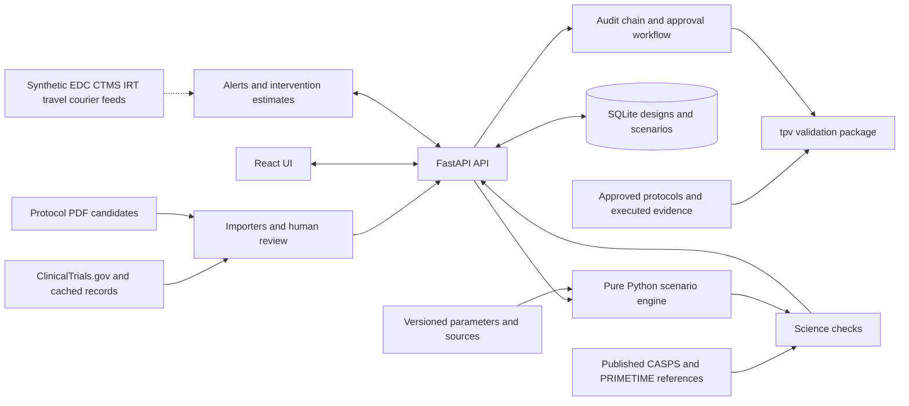

# TrialPilot

**Compare clinical trial designs across cost, site workload, patient travel and timeline risk, with carbon as an additional metric and evidence behind each estimate.**

TrialPilot is an MIT-licensed hackathon prototype connecting scenario planning, an operations command center and software-validation evidence.

**Build status:** integration is in progress. The walkthrough describes the intended demo. Product test results, science reproduction and performance need the owning module's completed handoff. Check [demo readiness](docs/DEMO_RUNBOOK.md) and the [A11 handoff](handoffs/A11.md) before presenting it as a working end-to-end system.

**Simulated feeds are synthetic.** Registry records and published reference values are sourced real data. Assumed visit schedules, operating events and UI mock results must retain their assumption, simulated or mock labels.

## Demo media

| Asset placeholder | Capture requirement | Status |
|---|---|---|
| Scenario screenshot | Trial identity, assumptions, levers, units and P10/P50/P90 | Pending A8 build |
| Provenance screenshot | Formula, resolved inputs, parameter versions and sources | Pending A8 build |
| Command center screenshot/GIF | Simulated-feed label, alert and intervention | Pending A9/A6 build |
| Approval/audit screenshot | Rejected self-approval and independent signature | Pending A9/A7 build |
| Backup video: `docs/assets/trialpilot-demo.mp4` | Actual application recording, exactly 03:00 | Not yet recorded |

Use actual application captures. The [video script](docs/VIDEO_SCRIPT.md) includes failure lines within its 180-second timeline.

## Why these decisions matter

These historical figures explain the levers. They are context, not TrialPilot savings or current price estimates.

| Bottleneck | Opened evidence | Interpretation |
|---|---|---|
| Procedures and site work | ASPE's 2014 report lists procedures **15–22%**, administrative staff **11–29%**, monitoring **9–14%**, site retention **9–16%**, and central laboratories **4–12%** across phases. [Report, PDF p. 34](https://aspe.hhs.gov/sites/default/files/migrated_legacy_files//44516/rpt_erg.pdf) | The detailed discussion excludes site overhead and sponsor monitoring. These ranges span phases and are not additive uncertainty bounds. |
| Pivotal trial expense | A 2018 study estimated a **$19.0m** median direct cost per pivotal trial among **138 trials** supporting **59 FDA approvals in 2015–2016**. [Original paper](https://pmc.ncbi.nlm.nih.gov/articles/PMC6248200/) | Historical modelled cost per trial, not total drug-development cost. |
| Study duration | FDA gives Phase 1 **several months**, Phase 2 **several months to 2 years**, and Phase 3 **1–4 years**. [FDA](https://www.fda.gov/patients/drug-development-process/step-3-clinical-research) | Educational ranges, not a forecast for the imported study. |
| Drug supply waste | Clinical Trials Arena reported an industry estimate of **60–70% clinical-trial IMP waste** on May 28, 2025. [Article](https://www.clinicaltrialsarena.com/news/mapping-out-opportunities-to-reduce-emissions-in-clinical-trials/) | Attributed conference estimate in coverage of a Genentech presentation, not a measured baseline for our trial. |

**Regeneron sheet verification is pending:** the starter sheets were not supplied. Tufts site statistics and exact sheet quotations remain unverified. The independent study/FDA figures above must not be described as Regeneron quotations. See the [claim ledger](docs/EVIDENCE.md).

## Architecture

Intended module boundaries. Dashed feed inputs represent synthetic demo events and future connectors.



| Directory | Responsibility |
|---|---|
| `contracts/` | Pydantic contracts, parameter schema, JSON Schema and TypeScript |
| `engine/` | Activity calculations, uncertainty, forecast and supply |
| `api/` | Persistence, importers, operations, compliance and HTTP/SSE |
| `web/` | Scenario, command, approval, audit and science views |
| `validation/` | `tpv`, requirements, protocols, evidence and traceability |
| `science/` | Published footprint fixtures and reproduction outputs |
| `data/` | Parameters, cached registry responses and synthetic fixtures |
| `docs/` | Methods, sources and the presentation package |

## Quick start

Commands follow the current Makefile and Compose configuration. **A11 has not verified a complete application launch.** Prepare dependencies, images and cached fixtures while online before rehearsing offline.

### Docker

Install Docker with Compose v2. Build once online, then start locally:

```bash
docker compose build
docker compose up
```

Open [TrialPilot](http://127.0.0.1:8000) and [API health](http://127.0.0.1:8000/api/health). Compose serves the built UI and `/api` on the same port. It defaults to `DEMO_OFFLINE=1`; `.env` can override it. Explicit offline start:

```bash
DEMO_OFFLINE=1 docker compose up
```

PowerShell equivalent:

```powershell
$env:DEMO_OFFLINE = '1'
docker compose up
```

A successful launch depends on A5's Dockerfile and A8's completed web build. Configuration alone does not prove it runs.

### Development

Requirements: Python 3.11+, `uv`, Node.js 20+, `pnpm`, GNU Make and Bash. On Windows use a configured WSL or Git Bash environment with these tools on PATH.

```bash
make install
make dev DEMO_OFFLINE=1
```

The UI is at [localhost:5173](http://localhost:5173), the API at [localhost:8000](http://localhost:8000/api/health). `make dev` alone uses the configured environment. A11 rehearsal uses reserved ports and a separate database:

```bash
make dev API_PORT=8011 WEB_PORT=5184 DEMO_OFFLINE=1 \
  TP_DB_PATH="$PWD/docs/.rehearsal.sqlite" \
  TP_CORS_ORIGINS=http://localhost:5184,http://127.0.0.1:5184
```

Stop only rehearsal processes. Do not delete a shared database to reset a demo. See [reset steps](docs/DEMO_RUNBOOK.md).

## Demo walkthrough

1. Import A4's verified cached Phase 3 trial. Check its registry identity and separate recorded facts from the assumed schedule.
2. Compare baseline with 50% remote monitoring, three eligible home visits and on-demand supply. Remove a procedure only if the fixture supports a scientifically acceptable demonstration.
3. Read cost, site staff hours, patient travel hours and duration ranges, then carbon. Show a cost increase when the computed result supports that trade-off.
4. Open a metric's provenance: formula, inputs, parameter version, citation and assumptions.
5. Save scenario B and submit it. Show rejected self-approval, then the required reviewer/QA sequence with distinct demo identities. Verify the chain.
6. Open the labelled synthetic feed. Inspect an overstock alert, plan an intervention and contrast its effect estimate with a coincidence/inconclusive case.
7. Open science and validation evidence. Quote actual gaps and executed checks, or say results are pending.

Exact controls and readiness gates appear in the [3-minute runbook](docs/DEMO_RUNBOOK.md). `VITE_MOCK_API=1` is a separate UI rehearsal mode and cannot establish engine, API or compliance behavior.

## Method and uncertainty

The design reuses activity inputs for cost, site time, patient travel and emissions. Carbon uses activity multiplied by emission factor under the LCCT method, limited to trial-specific activities beyond routine care. [Griffiths et al., 2024](https://pmc.ncbi.nlm.nih.gov/articles/PMC10823997/).

The specification calls for seeded triangular sampling with 2,000 draws and P10/P50/P90 outputs. These are model quantiles conditional on assumptions, without demonstrated real-world coverage. Consult the owner-written [engine methods](docs/model.md) and [forecast/supply methods](docs/model_forecast.md) as they become available.

Module ids: `setup`, `trial_management`, `meetings_travel`, `intervention`, `data_collection`, `supplies_equipment`, `patient_assessments`, `samples`, `laboratory`, `closeout`. `drug_supply` is an **extension beyond the published method** and must be separated from like-for-like reproduction. Missing inputs need a visible assumption or warning. Forecasts are planning estimates.

## Science check

| Trial | Published reference | TrialPilot output | Gap |
|---|---|---|---|
| CASPS | 72 t CO2e, rounded abstract value | Pending generated JSON and A10 handoff | Not reported |
| PRIMETIME | 89 t CO2e, rounded abstract value | Pending generated JSON and A10 handoff | Not reported |

Source: [BMJ Open 2024](https://pmc.ncbi.nlm.nih.gov/articles/PMC10823997/). These are published values, **not our reproduction results**. Use unrounded references, module boundaries and output values from `science/out/results.json` when available. Distinguish paper-factor arithmetic, a full A2 engine run and library-factor sensitivity. Carbon reproduction does not validate cost, forecast or intervention effects.

## Validation package

Once A7's CLI is installed, inspect supported options:

```bash
uv run --project validation tpv --help
uv run --project validation tpv package --help
```

The root Makefile invokes `tpv package` from `validation/`:

```bash
make validate
```

The intended package includes a plan, requirements, risks, approved protocols, executed evidence, traceability and a summary awaiting QA. Packaging alone does not establish executed or approved validation. Follow A7's instructions for independent review, signing and execution. AI-drafted text carries **DRAFT — requires human review**. The actual defect detection count is pending executed A7 evidence; the number planted is not the number detected.

## Frameworks, libraries, APIs, models and datasets

The [current complete direct-dependency list](THIRD_PARTY.md) is maintained by A1 from manifests and installed metadata. It identifies React, React DOM, React Router, Recharts, Vite, TypeScript, Tailwind, font/mapping packages, FastAPI, Pydantic, NumPy, SQLModel, SSE, PDF tooling and development tools individually. The [stack and licence supplement](docs/STACK_AND_LICENSES.md) covers runtime, API, model and dataset disclosures and additional licence checks. Resolve pending entries against the final build before submission. The project's MIT licence does not relicense dependencies or data.

Measured accuracy, time savings, defect detection and latency require the responsible module's handoff. The [Devpost draft](docs/DEVPOST.md) retains measurement placeholders until evidence exists.

## Limitations

- Registry records can omit schedules. Assumed visits and extracted candidates need human confirmation.
- Parameter quality and boundaries limit results. Carbon does not represent every environmental impact.
- Operating feeds are synthetic. Authorized production connectors remain future work unless separately evidenced.
- Difference-in-differences depends on comparison-group assumptions and can be confounded. Synthetic effects are not clinical findings.
- Demo identity headers do not provide production authentication. Hash chaining detects inconsistencies relative to trusted evidence but cannot prevent a privileged rewrite of a database and its whole chain.
- Prototype controls and generated documents do not establish regulatory acceptance. Security, deployment, clinical appropriateness and QA need separate assessment.
- Final captures, backup recording, generated science output and integrated rehearsal remain demo gates.

## Presentation package

[12-slide deck](docs/DECK.md) · [180-second script](docs/VIDEO_SCRIPT.md) · [Devpost draft](docs/DEVPOST.md) · [15 judge questions](docs/JUDGE_QA.md) · [demo runbook](docs/DEMO_RUNBOOK.md) · [claim ledger](docs/EVIDENCE.md)

## Licence

Original TrialPilot code and documentation use the [MIT licence](LICENSE). Source publications, APIs, datasets, fonts and dependencies retain their own terms. See [THIRD_PARTY.md](THIRD_PARTY.md) and the [licence supplement](docs/STACK_AND_LICENSES.md).
