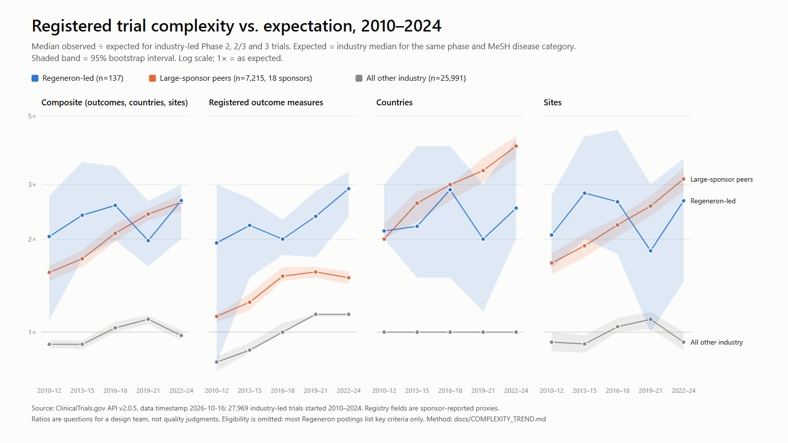

# Regeneron protocol complexity vs. industry expectation

This analysis answers the pro-tip in Regeneron's *How Extra Is Your Trial?* starter sheet: show how one sponsor's trial complexity has changed over time compared with the rest of industry, using observed vs. expected rather than raw counts, in 3-year start-date blocks. It uses public ClinicalTrials.gov registrations only. It is a descriptive mirror: a ratio above 1 is a question for a design team, not a judgment of quality.



## What it shows

1. **Regeneron-led trials sit at about 2.4× the expected composite complexity, and that level has been roughly flat since 2010.** Over 2010–2024 the median is 2.39× (95% CI 2.00–2.69, n=137). Block medians range from 1.98× to 2.67×, and every interval overlaps.
2. **Large sponsors have caught up.** The 18 lead sponsors with at least 200 analysed trials rose from 1.56× in 2010–12 to 2.63× in 2022–24. Most of the rise comes from countries (2.0× → 4.0×) and sites (1.67× → 3.13×). In 2022–24 the two groups are level on the composite: 2.67× (2.00–3.00) vs. 2.63× (2.47–2.80).
3. **Registered outcome measures are where Regeneron-led trials differ most.** In 2022–24 they register 2.91× the expected count (2.36–3.31, n=40). Large-sponsor peers register 1.50× (1.43–1.57), and the intervals do not overlap. The question this raises for a design team: how many registered outcome measures support key endpoints, and how many reflect registration granularity, such as a separate entry per timepoint or dose?
4. **Countries are lower than large-sponsor peers but not clearly so.** In 2022–24 the median is 2.52× vs. 4.00×, but Regeneron's interval (2.00–4.20) is wide and overlaps.
5. **Eligibility cannot be compared.** 85% of Regeneron-led postings list only "key" inclusion/exclusion criteria, against 9% of other industry postings and 14% of large-sponsor postings. Their criteria counts are therefore understated, and eligibility is left out of the composite.

Trials where Regeneron is a collaborator and a partner leads, for example Sanofi-led dupilumab trials such as BOREAS, are reported separately. Their composite is 2.51× (2.22–3.05, n=101), and their countries ratio is higher (4.50×).

## Method

**Data.** One ClinicalTrials.gov API v2 snapshot (API 2.0.5, data timestamp 2026-10-16, fetched 2026-10-18 UTC). The query covered industry-led interventional trials listing Phase 2 or Phase 3 with a start date in 2010–2024: 32,621 records. The query also returns Phase 1/2 records, which are excluded here. That leaves **27,969 trials** in Phase 2, Phase 2/3 and Phase 3. The compact per-trial table is [`data/fixtures/complexity/industry_phase23_2010_2024.jsonl.gz`](../data/fixtures/complexity/industry_phase23_2010_2024.jsonl.gz), with its [query metadata](../data/fixtures/complexity/download_meta.json).

**Measures** (registry proxies, not the protocol itself):

| Measure | Definition |
|---|---|
| Outcome measures | Registered primary + secondary + other outcome measures |
| Countries | Distinct countries among registered locations |
| Sites | Registered location entries |
| Eligibility criteria | Non-empty criteria lines, the same rule PeerMirror uses; reported, but excluded from the composite |
| Composite | Geometric mean of the outcomes, countries and sites ratios (trials reporting all three) |

A count that is not reported, such as no locations listed, is treated as missing, never as zero.

**Expected value.** For each trial and measure, the expected value is the median among *industry-led trials with no Regeneron involvement* in the same phase and the same MeSH disease category. Categories are the 25 top-level descriptors of MeSH tree C plus Mental Disorders, read from the record's condition MeSH terms and ancestors. A trial in several categories takes the mean of their medians. A category is used only when it has at least 20 reference trials; otherwise the phase-wide median is used, which happened for 18 of roughly 110,000 ratios. Trials with no disease category form their own "Unclassified" group per phase. Ratio = observed ÷ expected, so 1.0 means typical for the phase and disease area. The baseline pools all years, which lets the industry line itself show the trend.

**Groups.**

| Group | Rule | Trials |
|---|---|---:|
| Regeneron-led | Lead sponsor name contains "Regeneron" (one spelling in this snapshot) | 142 |
| Regeneron as collaborator | Regeneron listed as collaborator, partner leads | 102 |
| All other industry | Everything else; this is also the reference population | 27,725 |
| Large-sponsor peers | Context subset of all other industry: the 18 lead-sponsor names with ≥ 200 analysed trials (AbbVie, Amgen, AstraZeneca, Bayer, Boehringer Ingelheim, Bristol-Myers Squibb, Eli Lilly, Gilead, GlaxoSmithKline, Hoffmann-La Roche, Janssen R&D, Jiangsu HengRui, MSD, Novartis, Novo Nordisk, Pfizer, Sanofi, Takeda). Raw names, not merged | 7,746 |

**Statistics.** The median ratio per group and 3-year start block, with a 95% percentile bootstrap interval (2,000 resamples, seed 7, seeded per group, period and measure). Blocks with fewer than 10 trials are flagged ⚠. The JSON also gives each group's ratio of medians relative to all other industry, with a two-sample bootstrap interval. Every number below is in [`complexity/complexity_trend.json`](complexity/complexity_trend.json).

## Results

Median observed ÷ expected (95% bootstrap interval), n = trials reporting the measure.

#### Composite

| Group | 2010–2012 | 2013–2015 | 2016–2018 | 2019–2021 | 2022–2024 | 2010–2024 |
|---|---:|---:|---:|---:|---:|---:|
| All other industry | 0.91 (0.89–0.94), n=5287 | 0.91 (0.88–0.94), n=4970 | 1.03 (1.00–1.08), n=4907 | 1.10 (1.06–1.13), n=5546 | 0.98 (0.94–1.01), n=5281 | 0.98 (0.97–1.00), n=25991 |
| Large-sponsor peers | 1.56 (1.46–1.64), n=1838 | 1.73 (1.62–1.84), n=1495 | 2.09 (1.96–2.25), n=1268 | 2.41 (2.30–2.51), n=1418 | 2.63 (2.47–2.80), n=1196 | 1.98 (1.92–2.03), n=7215 |
| Regeneron-led | 2.04 (1.09–2.77), n=12 | 2.39 (1.73–3.55), n=17 | 2.57 (1.98–3.44), n=31 | 1.98 (1.63–2.65), n=38 | 2.67 (2.00–3.00), n=39 | 2.39 (2.00–2.69), n=137 |
| Regeneron as collaborator | 1.87 (1.52–3.63), n=23 | 2.40 (1.01–3.31), n=23 | 2.83 (1.83–3.79), n=20 | 3.44 (2.26–4.94), n=21 | 2.59 (2.22–5.25), n=14 | 2.51 (2.22–3.05), n=101 |

#### Outcome measures

| Group | 2010–2012 | 2013–2015 | 2016–2018 | 2019–2021 | 2022–2024 | 2010–2024 |
|---|---:|---:|---:|---:|---:|---:|
| All other industry | 0.80 (0.75–0.83), n=5752 | 0.88 (0.86–0.92), n=5434 | 1.00 (1.00–1.07), n=5157 | 1.14 (1.12–1.14), n=5789 | 1.14 (1.12–1.14), n=5585 | 1.00 (1.00–1.00), n=27717 |
| Large-sponsor peers | 1.12 (1.08–1.14), n=2013 | 1.25 (1.18–1.33), n=1711 | 1.52 (1.47–1.62), n=1341 | 1.57 (1.50–1.62), n=1457 | 1.50 (1.43–1.57), n=1224 | 1.38 (1.33–1.38), n=7746 |
| Regeneron-led | 1.94 (0.79–3.00), n=12 | 2.22 (1.50–2.71), n=18 | 2.00 (1.78–2.31), n=31 | 2.37 (1.75–2.86), n=41 | 2.91 (2.36–3.31), n=40 | 2.35 (2.10–2.67), n=142 |
| Regeneron as collaborator | 1.50 (0.91–2.88), n=23 | 1.70 (1.04–2.88), n=24 | 2.31 (1.45–2.97), n=20 | 2.00 (1.76–2.62), n=21 | 1.66 (1.50–2.00), n=14 | 1.88 (1.65–2.19), n=102 |

#### Countries

| Group | 2010–2012 | 2013–2015 | 2016–2018 | 2019–2021 | 2022–2024 | 2010–2024 |
|---|---:|---:|---:|---:|---:|---:|
| All other industry | 1.00 (1.00–1.00), n=5294 | 1.00 (1.00–1.00), n=4970 | 1.00 (1.00–1.00), n=4907 | 1.00 (1.00–1.00), n=5546 | 1.00 (1.00–1.00), n=5281 | 1.00 (1.00–1.00), n=25998 |
| Large-sponsor peers | 2.00 (2.00–2.25), n=1838 | 2.62 (2.28–2.86), n=1495 | 3.00 (2.67–3.00), n=1268 | 3.33 (3.05–3.67), n=1418 | 4.00 (3.68–4.31), n=1196 | 3.00 (2.86–3.00), n=7215 |
| Regeneron-led | 2.12 (2.00–3.00), n=12 | 2.20 (1.50–4.00), n=17 | 2.89 (1.50–4.00), n=31 | 2.00 (1.17–3.00), n=38 | 2.52 (2.00–4.20), n=39 | 2.44 (2.00–2.89), n=137 |
| Regeneron as collaborator | 4.12 (1.00–7.50), n=23 | 3.75 (1.00–5.33), n=23 | 5.47 (3.10–9.33), n=20 | 7.00 (2.67–10.50), n=21 | 5.67 (3.00–10.05), n=14 | 4.50 (3.75–5.67), n=101 |

Country counts are small integers (often one country), so the median other-industry trial matches its expected count exactly and the ratio is 1.00 in every block.

#### Sites

| Group | 2010–2012 | 2013–2015 | 2016–2018 | 2019–2021 | 2022–2024 | 2010–2024 |
|---|---:|---:|---:|---:|---:|---:|
| All other industry | 0.93 (0.87–1.00), n=5294 | 0.92 (0.86–0.98), n=4970 | 1.04 (1.00–1.11), n=4907 | 1.10 (1.02–1.16), n=5546 | 0.93 (0.88–1.00), n=5281 | 1.00 (0.96–1.00), n=25998 |
| Large-sponsor peers | 1.67 (1.54–1.80), n=1838 | 1.90 (1.75–2.08), n=1495 | 2.22 (2.04–2.35), n=1268 | 2.56 (2.38–2.76), n=1418 | 3.13 (2.87–3.40), n=1196 | 2.18 (2.12–2.26), n=7215 |
| Regeneron-led | 2.06 (1.61–2.77), n=12 | 2.82 (2.00–4.30), n=17 | 2.64 (1.79–4.52), n=31 | 1.83 (1.00–3.01), n=38 | 2.66 (1.45–3.64), n=39 | 2.48 (2.00–2.81), n=137 |
| Regeneron as collaborator | 2.58 (1.17–4.75), n=23 | 2.23 (1.58–3.80), n=23 | 2.16 (1.56–3.05), n=20 | 3.15 (1.94–4.86), n=21 | 2.88 (1.66–7.08), n=14 | 2.49 (2.13–3.47), n=101 |

#### Eligibility criteria (all postings; not comparable for Regeneron-led)

| Group | 2010–2012 | 2013–2015 | 2016–2018 | 2019–2021 | 2022–2024 | 2010–2024 |
|---|---:|---:|---:|---:|---:|---:|
| All other industry | 0.86 (0.84–0.89), n=5748 | 0.93 (0.90–0.94), n=5411 | 1.04 (1.00–1.06), n=5135 | 1.06 (1.05–1.10), n=5789 | 1.08 (1.06–1.11), n=5583 | 1.00 (1.00–1.00), n=27666 |
| Large-sponsor peers | 0.81 (0.77–0.83), n=2008 | 0.86 (0.82–0.89), n=1689 | 0.95 (0.92–1.00), n=1321 | 1.00 (0.97–1.06), n=1457 | 0.97 (0.94–1.00), n=1223 | 0.90 (0.89–0.93), n=7698 |
| Regeneron-led | 0.73 (0.59–0.92), n=12 | 0.88 (0.76–0.98), n=18 | 0.93 (0.75–1.12), n=31 | 0.78 (0.76–0.87), n=41 | 0.78 (0.67–0.91), n=40 | 0.83 (0.77–0.88), n=142 |
| Regeneron as collaborator | 0.75 (0.53–1.06), n=23 | 0.64 (0.59–0.83), n=24 | 1.11 (0.96–1.29), n=20 | 1.38 (1.00–1.65), n=21 | 1.06 (0.82–1.17), n=14 | 1.00 (0.81–1.06), n=102 |

Restricted to full (non-"key") postings, Regeneron-led trials number only 22 (0.91×, 0.80–1.29), with no full posting at all in 2022–24. The JSON keeps this as `eligibility_full_only`.

## Limits

- Registry fields are sponsor-reported. Outcome-measure counts depend on how finely a sponsor registers measures; location lists can be incomplete or include closed sites. The sheet itself warns that counting outcome measures as a stand-in for endpoints is "useful, imperfect, and easy to misread".
- Phase and MeSH category do not capture indication severity, endpoint type, regional strategy or programme size, so residual case-mix differences remain. The large-sponsor peer group shows how much of a gap simply reflects programme scale.
- Sponsor names are raw lead-sponsor strings. Merged or renamed companies are not consolidated, which matters for the peer group and not for Regeneron, whose name has one spelling in this snapshot.
- Visits and procedures are not reconstructed from registry fields here; the sheet's "implied visits and procedures" dimension remains future work.
- No association with duration, termination or cost is estimated. These ratios describe registration, not outcomes.

## Reproduce

From `api/` with its virtual environment:

```bash
python -m trialpilot_api.benchmark.trend fetch      # network: re-download the snapshot
python -m trialpilot_api.benchmark.trend analyze    # offline: rewrite complexity_trend.json
python -m trialpilot_api.benchmark.trend_chart      # rewrite complexity_trend.svg
```

The PNG is the SVG rendered at 1600 × 900 in headless Microsoft Edge. `pytest tests/test_benchmark_trend.py` checks the counting rules and the sponsor-free expectation. It also re-runs the analysis on the committed table and compares every group, period and measure count and median with the committed JSON.
